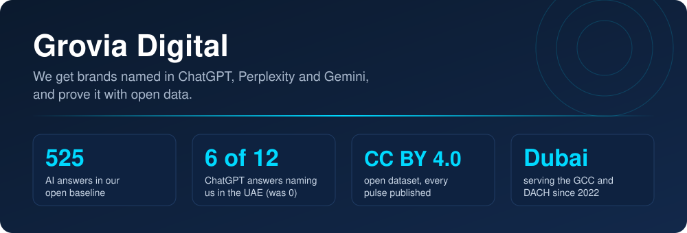

 

### 🎯 Who we are

Grovia Digital is a Dubai-based agency for AI search visibility (GEO), ChatGPT Ads,
performance marketing and AI consulting, serving SMEs in the GCC and DACH. We get
brands named in the answers of ChatGPT, Perplexity and Gemini, and prove it with open
measurement data, including on ourselves.

### 🧭 What we do

| Service | What it means | |
| --- | --- | --- |
| **AI search visibility (GEO)** | We measure which providers ChatGPT, Perplexity and Gemini name for your buyers' questions, then build the pages and sources that get you named | [→](https://www.grovia-digital.com/en/ai-visibility/) |
| **ChatGPT Ads** | Campaigns inside ChatGPT, with tracking that ties clicks to leads | [→](https://www.grovia-digital.com/en/services/) |
| **Performance marketing** | Google, Meta and LinkedIn Ads aimed at inquiries and sales | [→](https://www.grovia-digital.com/en/performance-marketing/) |
| **AI consulting & automation** | AI decisions for SMEs, then the systems that run in production | [→](https://www.grovia-digital.com/en/ai-transformation/) |

### 📊 Our own proof

In September 2026 we asked ChatGPT, Perplexity and Gemini 35 buyer questions, five
times each. Across 525 answers, Grovia Digital was named 0 times. After changes to our
own pages and profiles, Perplexity named us on a German buyer question in 2 of 3 runs
on 8 October. On 22 October, ChatGPT named us in 6 of 12 measurements on questions from
buyers in the UAE, on "ai visibility agency uae" in 3 of 3 runs. On our German and
international questions no assistant named us that day (0 of 90), and Gemini has not
named us so far. We publish every result.

→ [Case: how Perplexity started naming Grovia Digital](https://www.grovia-digital.com/en/case-studies/grovia-named-by-perplexity/)

### 🔓 Open data

We publish every measurement as an open dataset under CC BY 4.0.

| Measurement | Date | Answers |
| --- | --- | --- |
| Baseline | 2–9 Sep 2026 | 525 |
| Pulse P1 | 24 Sep 2026 | 114 |
| Pulse P2 | 8 Oct 2026 | 90 |
| Pulse P3 | 22 Oct 2026 | 114 |

📁 [grovia-ai-visibility-index](https://github.com/Grovia-Digital/grovia-ai-visibility-index) · 🌐 [live index with diary](https://www.grovia-digital.com/en/geo-visibility-index/)

### 🔬 How we measure

- A frozen set of buyer questions in German and English
- Several runs per platform under the same conditions (new chat, memory off, VPN exit Frankfurt)
- One count per provider per answer, sources recorded per answer
- Raw data published, limitations declared

### 🧩 Selected work

- [How Perplexity started naming Grovia Digital](https://www.grovia-digital.com/en/case-studies/grovia-named-by-perplexity/)
- [AI voice agent for candidate reactivation](https://www.grovia-digital.com/en/case-studies/ai-voice-agent-reactivation/)
- [Gusto AI: AI app from idea to launch](https://www.grovia-digital.com/en/case-studies/gusto-ai-food-intelligence/)
- [Personal branding for a mortgage advisor: 1.8k to 29.8k TikTok followers](https://www.grovia-digital.com/en/case-studies/my-baufinanzierung-personal-branding/)

### 📍 Company

Grovia Management Consultancy L.L.C · Westburry Tower 1, Business Bay, Dubai, UAE ·
trade licence 1017492 · founded 2022 by Kristina Knodel (CEO) and
[Alexander Knodel](https://github.com/KnAlex83) (CTO) · working in English and German.
